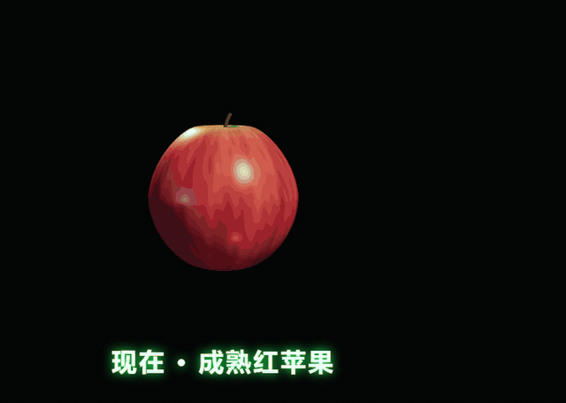
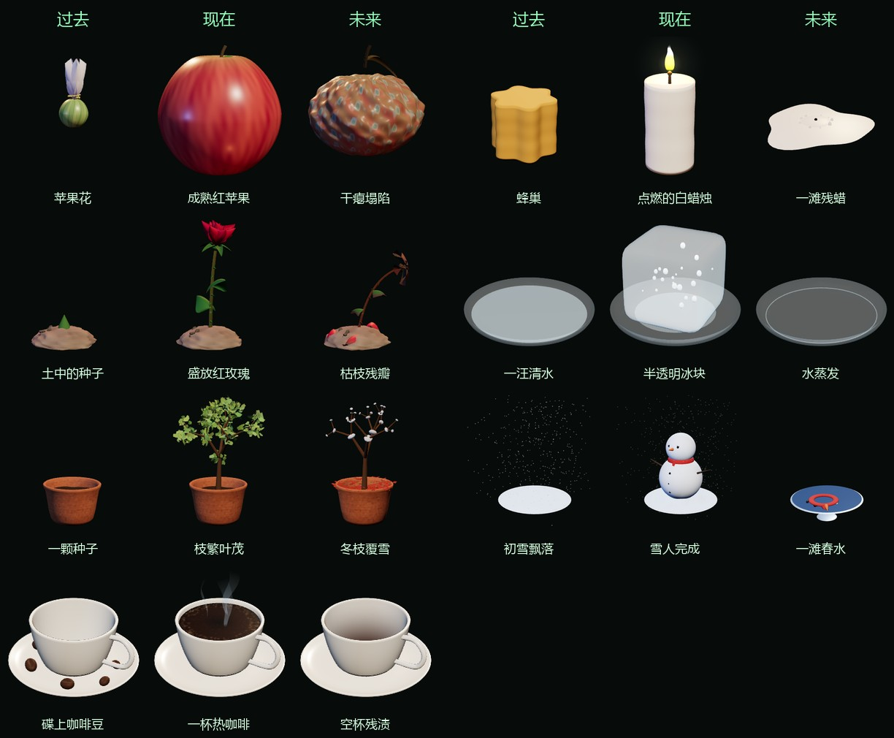

# 时间模拟器

张开手掌召唤法阵，转动手腕，让物品在时间里前进或倒流：苹果从开花到成熟、被咬、腐烂，再倒回去。

**在线体验**：[魔搭创空间 · 时间模拟器](https://www.modelscope.cn/studios/c8iolab/time-simulator)，打开后允许摄像头就能玩（用 AI 生成物品需要你自己的 Key）。

<p align="center"></p>

全部在浏览器里运行：MediaPipe 识别手和手臂，three.js 渲染法阵和 3D 物品。物品不是写死的：在设置面板里填上 DeepSeek（或任何兼容 OpenAI 格式的接口）的 Key，写一句话，就能生成一个新的 3D 时间物品。

<p align="center"></p>

## 功能

- **手势**：张开手掌，在掌心召唤法阵，法阵贴着掌面、跟着手掌倾斜，大小跟着手在画面里的大小走：手往镜头前推就变大，往后撤就变小。两只手各有一个法阵。
- **前臂符文环**：3 个环沿手腕到手肘排开，方向跟着手实时转，不用等手肘识别；识别到手肘以后，再按真实的手腕弯曲、前臂长度和前臂朝镜头倾斜的角度修正。环背面被手臂挡住的那段会变暗，看起来是套在手臂上。
- **拨动时间**：张开手掌、法阵出来就能控制，不用碰到物品；时间在动时，会有一串光点从法阵飞向物品。法阵就是一个拿在手里的拨盘：手腕转多少度，时间就走多少，没有惯性，转回同样的角度就回到同样的时间。外圈刻度的正上方是“现在”，顺时针是未来、逆时针是过去，亮点指着当前时间，拨到尽头会响一声钟；跨过一个阶段时，下方会浮现阶段名。
- **流畅**：手势识别放在后台线程里跑，画面始终 60 帧，不会被识别拖慢；两次识别之间按速度连续推算法阵位置，丢一两帧、左右手标签偶尔翻转也不会闪或跳。
- **3D 时间物品**：内置 7 个 3D 物品：苹果、白蜡烛、红玫瑰、冰块、盆栽小树、雪人、咖啡，每个 7–9 个阶段；另有一个平面图片版苹果。3D 物品都是 DeepSeek 写的程序化模型，没有用任何图片或模型文件。
- **一句话生成物品**：在设置面板里描述物品和它的过去、未来，几分钟后自动生成、检查语法、保存并载入。
- **声音**：召唤声、嗡鸣、拨动时的嘀嗒声、尽头的钟声都是实时合成的；背景是合成的氛围音，也可以换成自己的音乐。

## 快速开始

需要 Python 3.8+、Chrome 或 Edge、一个摄像头（没有也能用鼠标玩）。

```bash
git clone https://github.com/diw35688-sketch/time-simulator.git
cd time-simulator
python download_models.py   # 把手势和姿态模型下载到本地，约 33MB；国内建议先开代理
python server.py            # Windows 也可以直接双击 start.bat，第一次会自动下载模型
```

浏览器打开 <http://127.0.0.1:8765/>，允许使用摄像头。一定要用这个地址打开，直接双击 `index.html` 的话浏览器不给摄像头权限。

不下载模型也能运行，页面会改从 jsdelivr 和 Google 在线加载（国内经常加载不动），只是没有手臂追踪。

## 怎么玩

| | 手势 | 没有摄像头时 |
|---|---|---|
| 召唤法阵 | 张开手掌 | 鼠标移进画面 |
| 控制物品 | 张开手掌就行，不用靠近物品，右上角显示「控制中」 | 鼠标移进画面 |
| 拨动时间 | 转动手腕：顺时针去未来，逆时针回过去 | 滚轮，一格走 0.1 |
| 松开拨盘 | 握拳，时间停在原处。手腕转不动了就先握拳，转回来再张开接着拨 | — |

- 默认手腕转 150° 走完整个生命周期（从现在往未来、往过去各约 75°）。地址后面加 `?deg=120` 可以调，范围 30–720。
- 键盘：`D` 显示/隐藏手部骨架，`M` 静音，`B` 切换背景音乐。声音要先在页面上点一下才会开，这是浏览器的限制。
- 右上角显示帧率、识别速度（每秒几次、每次多少毫秒、延迟）、时间值、当前阶段和识别状态；有多个摄像头时，左下角可以切换。
- 识别先在 CPU 上启动（一两秒就能用），同时在后台给 GPU 上的手和手臂（手肘）两个识别线程预热，都好了再一起换过去，预热时不会拖慢正在用的识别。GPU 第一次要编译着色器，第一次打开可能要十几秒，之后会快很多。
- 识别要用的 wasm 和模型（共约 23MB）下载一次就存进浏览器缓存。在线版从魔搭模型库 [c8iolab/time-simulator-assets](https://www.modelscope.cn/models/c8iolab/time-simulator-assets) 的 CDN 下载（每秒几 MB），本机运行先用 `vendor/` 里的；下载进度显示在右上角。
- 其他地址参数：`?nocam` 不开摄像头，只用鼠标；`?object=objects/candle.html` 直接打开某个物品；`?debug` 显示手部骨架；`?delegate=cpu` 或 `gpu` 只用一种识别方式；`?detector=main` 把识别放回主线程（排查问题用）。

## 用 AI 生成你自己的物品

1. 点左上角「⚙ 物品与 AI」。
2. 填 API 地址、Key 和模型，点「测试连接」。任何兼容 OpenAI Chat Completions 的服务都可以，比如 DeepSeek 官方的 `https://api.deepseek.com`，模型名以服务商的文档为准。连接成功后，模型输入框里可以直接选。
3. 写一句描述，比如「一根点燃的白蜡烛。过去：蜂巢 → 蜡块 → 新蜡烛；未来：越烧越短 → 蜡泪堆积 → 熄灭冒烟 → 一滩残蜡」，点「生成」。
4. 等 1–5 分钟。生成完会先用 JS 解析器检查语法，有错就把出错的几行发回给模型修（最多 2 轮），然后保存到 `objects/user/` 并自动载入。

几点经验：

- 带思考过程的模型，要把「最大输出 token」设到 64000 以上，不然思考过程会把额度用光、一行代码都写不出来。内置物品是用 DeepSeek V4.1 Flash 生成的，每个 3–5 分钟。
- AI 写的物品经常有一两处低级错误：忘了把画布加进页面、代码里混进乱码、嵌入模式下页面背景不透明（会把摄像头画面整个盖住）、配件在不该出现的阶段悬在半空。最常见的背景问题现在生成时会自动补上；内置物品人工修过的地方都记在 `objects/index.json` 里。生成后看不到东西，就跑一下下面的验收脚本。
- **Key 的安全**：Key 只保存在你浏览器的 localStorage 里，由本机的 `server.py` 转发给你填的地址，不会写进任何文件。`server.py` 只监听 127.0.0.1，只对外提供页面需要的文件，接口要带自定义请求头，别的网站调用不了。物品运行在沙箱 iframe 里，拿不到页面的存储，读不到 Key。

想用命令行批量生成，可以用 `tools/td.py`，配置方法见 `.env.example`。

## 物品是怎么工作的

一个物品就是一个独立的 HTML 文件。宿主页面把它放进透明的沙箱 iframe，叠在摄像头画面上，用 postMessage 驱动时间：

```js
// 宿主 → 物品：t ∈ [-1, 1]，-1 是过去，0 是现在，+1 是未来
{ type: 'timespell:setTime', t }
// 物品 → 宿主（可选）：阶段列表，用来在右上角显示阶段名
{ type: 'timespell:stages', stages: [{ t: -1, name: '苹果花' }, /* … */ { t: 1, name: '干瘪塌陷' }] }
```

规范要点，完整版见 [`prompts/object_task.md`](prompts/object_task.md)（生成物品时发给模型的就是这份）：

- **画面必须是 t 的纯函数**：同一个 t 每次渲染要逐像素一致，不能依赖累积状态、`Math.random` 或时钟，这样往回拨才能精确复原。
- `?embed=1` 时背景透明、不显示 UI，物品中心在画面 (50%, 60%)，最大尺寸约为 `min(宽, 高) × 0.35`。
- three.js 从 `/vendor/three/three.module.js` 引入（r160），不加载任何外部文件，几何和纹理都用代码生成。
- 实现 `window.setTime(t)`、`getTime()`、`getStages()`。

## 贡献物品

1. 生成或手写一个物品，在页面里拨一拨，看看效果。
2. 跑自动验收，不需要开服务：
   ```bash
   pip install playwright numpy pillow
   python -m playwright install chromium
   python tests/check_object.py objects/user/你的物品.html
   ```
   它会检查：没有报错、帧率 ≥ 30、往回拨逐像素复原、嵌入模式透明且没有 UI、过去/现在/未来明显不同、没有外部请求，以及连续拨 240 帧每帧不超过 20ms、内存不涨。
3. 把文件移到 `objects/`，在 [`objects/index.json`](objects/index.json) 里加一条（名字、文件、描述、用的模型），然后提 PR。

法阵、手感、声音方面的改进，也欢迎提 issue 或 PR。

其他测试：

- `node tests/check_tracker.mjs`：不需要浏览器。用合成的手部和手肘数据（带抖动、丢帧、左右手标签翻转、识别延迟、手腕弯曲，另有一组慢电脑数据）跑跟踪和拨盘算法，和旧算法逐项对比：静止抖动、移动延迟、每帧平滑度、停下冲过头、转 60° 后时间是否准、转回能否回到原处、远离物品能否控制、手推近时法阵变大的延迟、前臂方向和手腕位置的误差等。`tests/sweep_tracker.mjs` 用同一组数据扫参数。
- `python tests/check_startup.py`：冷启动 35 秒，每秒记一次识别状态，看 CPU → GPU → 手臂的切换过程中识别有没有卡住。
- `python tests/check_handvideo.py`：把一张手的照片按已知角度合成成视频，当虚拟摄像头喂给真的 MediaPipe，对比后台线程和主线程两种识别方式的帧率、卡顿帧、识别延迟和拨时间的准确度。`python tests/check_live.py` 用同一段视频测线上的魔搭创空间。
- `tests/check_server_security.py` 测服务的安全限制（加 `--public` 测在线版），`tests/check_mouse.py` 测法阵和物品联动（加 `--fresh` 只用 git 里的文件，模拟刚 clone 的仓库），`tests/check_cam.py` 用虚拟摄像头测模型加载。
- `check_server.py`、`check_studio.py`、`check_repair.py` 会调用真实的 AI 接口，需要先运行 `server.py` 并配置 `.env`。

## 部署到魔搭创空间

仓库里带了 `Dockerfile` 和 `ms_deploy.json`，可以部署成魔搭的 Docker 创空间。用免费的 2 核 16G CPU 实例就够，手势识别和渲染都在访问者自己的浏览器里跑。

```bash
pip install modelscope
modelscope login --token 你的访问令牌   # 令牌在 https://modelscope.cn/my/myaccesstoken
python download_models.py               # 模型文件要一起传上去
python tools/deploy_modelscope.py 你的魔搭用户名/time-simulator
```

脚本会打包当前提交和模型文件（超过 4MB 的拆成几块，构建时再拼回去），推送到创空间仓库并触发部署。创空间自己的带宽只有几十 KB/s，所以页面会优先从魔搭模型库的 CDN 下载大文件，文本文件由 `server.py` 用 gzip 压缩后发送。在线版以公开模式运行（`TIMESPELL_PUBLIC=1`）：只转发到常见的 AI 服务，按 IP 限流；访问者生成的物品用随机文件名保存，7 天后清理，不会出现在别人的列表里。

## 常见问题

- **摄像头画面是黑的，或者是 ToDesk 之类的画面**：远程桌面软件会装虚拟摄像头，浏览器可能默认选中它。页面会自动跳过名字里带 ToDesk、OBS、Virtual 的设备，也可以在左下角手动切换。
- **一直显示「加载手势模型」**：运行 `python download_models.py`，把模型下载到本地后刷新。
- **法阵跟手慢**：看右上角的识别速度。刚打开时先用 CPU 识别，有的电脑每秒只有几次，等 GPU 预热好（第一次十几秒，之后几秒）会自动变快。
- **生成失败，提示输出被截断**：把「最大输出 token」调大。
- **没有声音**：先在页面上点一下。

目前只在 Windows + Chrome 上测试过，手势的手感参数还在调，欢迎反馈。

## 项目结构

```
index.html              宿主页面
js/main.js              摄像头、法阵、声音和主循环
js/tracker.js           手部跟踪和拨盘：去抖、两次识别之间的推算、前臂方向、拨时间（不依赖浏览器，可以单独测）
js/detector-worker.js   在后台线程里跑 MediaPipe 手势和姿态识别
studio.js               设置面板：物品选择、AI 接口、一句话生成和自动修复
server.py               服务：静态文件、AI 接口转发、保存生成的物品（TIMESPELL_PUBLIC=1 是在线版）
Dockerfile              魔搭创空间等平台的部署配置（配合 ms_deploy.json）
download_models.py      把 MediaPipe 运行文件和模型下载到 vendor/mediapipe
prompts/object_task.md  生成物品的提示词模板，也是物品规范
objects/                内置物品，index.json 是物品清单
objects/user/           你生成的物品（不进仓库）
tests/                  自动验收和回归测试（Playwright）
tools/                  命令行生成（td.py）、生成物品的通用修补（objfix.py）、录制演示动图（record_demo.py）、部署到魔搭（deploy_modelscope.py）
vendor/                 three.js r160、acorn
```

## 致谢

- [MediaPipe](https://ai.google.dev/edge/mediapipe) 的 Hand Landmarker 和 Pose Landmarker：识别手和手臂（Apache-2.0）
- [three.js](https://threejs.org/)：渲染（MIT）
- [acorn](https://github.com/acornjs/acorn)：检查生成代码的语法（MIT）
- DeepSeek V4.1 Flash 写了 8 个内置物品的代码，Seedream 5.0 生成了平面版苹果的图片和测试用的手部照片

## 许可与声明

代码以 [MIT](LICENSE) 许可开源，`vendor/` 里的第三方库保留各自的许可。

灵感来自电影《奇异博士》（2016）里用时间法术让苹果复原又腐烂的那场戏。本项目是独立的粉丝作品，与漫威、迪士尼没有任何关系；法阵、符文和物品全部由代码生成，没有使用电影里的任何素材。

仓库不包含背景音乐。在 `assets/audio/` 下放自己的 `bgm_a.mp3`、`bgm_b.mp3` 就会自动用上。

## English

**Time Simulator**: open your palm to summon a glowing circle, then twist your wrist to scrub an object through time. An apple blossoms, ripens, gets bitten, rots, and rewinds. Everything runs in the browser (MediaPipe hand and pose tracking, three.js). Each object is a standalone HTML page driven by a tiny postMessage protocol, and you can generate new ones from a one-line description with any OpenAI-compatible API such as DeepSeek.

Live demo: https://www.modelscope.cn/studios/c8iolab/time-simulator . Quick start: `python download_models.py && python server.py`, then open <http://127.0.0.1:8765/>. MIT licensed. A fan project inspired by *Doctor Strange* (2016); not affiliated with Marvel or Disney.
